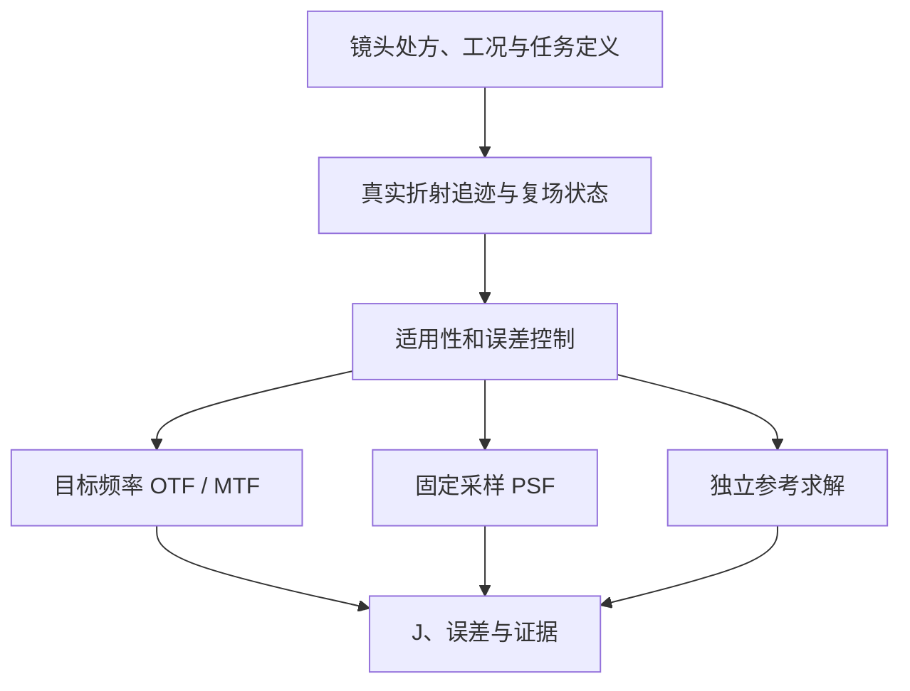

# Qfilm 下一代求解架构提案：0.5 候选

日期：2026-10-30。性质：设计提案，不代表新解算器已经实现、部署或通过11处方验证。目标是保留Qfilm的成像评价任务与可审计性，重构其求解表示、数值算子、误差控制和执行方式。

## 1. 设计结论

建议采用：**真实折射光线追迹 → 有通量与相位约定的局部复场 → 按目标观测量选择快速算子 → 自适应精度控制 → J及证据**。

核心观测量是指定空间频率的复OTF、MTF和当前J所需的几何/照度指标。完整PSF是同一模型下的另一种输出，保留0.25 µm点采样，并单独声明探测器像素面积积分。高成本参考计算用于独立验收。每个候选、视场和波长都检查适用条件，尤其面向大参数变化的COTS搜索。

目前0.4的主要代价是逐源点×逐像点的直接求和、整套CPU/GPU重算、以及即使联合验证网格/预算无法完成仍启动长计算。0.5需要改变任务组织和计算复杂度；仅调整分块或扩大预算不足以构成完整改进。



## 2. SOTA依据与取舍

截至本次检索，以下工作提供了可借鉴的方向；它们不是在全部Qfilm工况上经过统一比较的冠军算法。

| 工作 | 可借鉴内容 | 不能直接作出的推论 |
|---|---|---|
| Yang et al., SIGGRAPH Asia 2024 ray-wave | 用光线描述折射几何，以复场传播衍射。[R1] | 项目代码或论文算例不能直接认证Qfilm的所有处方与离轴像面 |
| UniRW, Optics Express 2026；Cheng et al., ACS Photonics 2026 | 模块化光线—波动耦合及复杂衍射表面。[R2,R3] | 混合DOE的图像重建PSNR改善不等于常规镜头MTF误差界 |
| Kang et al., GAPC-ASM, Optics Express 2026 | 解析处理载频、全局相位及几何相关相位，减少不必要采样。[R4] | 论文包含厚结构近似；不能把多片强折射系统直接压成一个未经验证的薄相位片 |
| Heintzmann et al., SAS, Optica 2023及后续实现 | 缩放角谱、带限与传播距离/倍率约束。[R5] | 不保证任意输入输出步长或任意聚焦条件均适用；细像面采样还需选择正确方向/缩放公式 |
| Ashcraft et al., Optics Express 2024 | 束元在公共平面上的高效求值；Poke提供研究实现。[R6] | 束元数、重叠、硬光阑和重构误差仍需收敛检查 |
| DiffRayve, 2026-09预印本 | 面向偏振和折射—衍射耦合的SBR方向。[R7] | 目前按预印本和待审计实现对待，不直接设为生产默认 |

本方案借鉴解析相位处理和混合建模思想，但第一阶段继续真实追迹每个厚镜片的折射、光程和截光；不以薄透镜近似替代这些已明确需要保留的物理效应。

## 3. 冻结任务契约

每个任务先声明：

- 处方、玻璃n(lambda)、非球面项约定、物方状态、真实光阑与固定物理像面。
- 视场网格、传感器面积权重、波长与光谱权重；三个径向场仅作为当前回归集，不能自动等同整个连续画幅已认证。
- 目标空间频率、物理像面坐标、TS方向约定、色差位移及中心参考。
- MTF针对理想光学PSF还是包括像素孔径响应；0.25 µm数值点间距不能等同实物像素尺寸。
- PSF输出范围、0.25 µm步长、强度单位/归一化，以及OTF针对全像面还是有限窗口。
- J公式、硬约束、模型版本、数值误差目标和预算。

保留现有J的组成和面积/尾部加权方式。若将当前有限窗口归一化MTF改为全像面OTF，必须建立新的objective版本或证明两者误差在任务要求内；旧标签不得静默复用。

## 4. 统一的光线与复场状态

每个condition=(设计、视场、波长、物方状态)的状态保存：

- 输入采样位置、实际源点坐标、折射后方向、OPL和解析参考相位。
- 每条光线代表的输入功率、透射权重；按定义考虑Fresnel透射及后续可选Jones偏振传输。
- 物理场振幅、积分面积/求积权重分别保存，避免把已经乘过Jacobian的量再次作为场振幅使用。
- 瞳面映射、可见区域、边界与连通分片、遮挡和采样失败原因。
- 参考面/参考球面、全局物理像点位置及单位约定。

未提供镀膜、散射或制造公差数据时，分别声明未建模，不能用默认数值替代物理校准。首先在已声明的几何光学有效区间重建复场，并验证功率闭合。对于大角度场，轴向通量和简单的sum|U|²需按场与谱的约定区分。

32条有效光线、单个chief ray或20%填充率不能单独作为“镜头物理不可成像”的通用判据。需要区分：未命中光阑的ray aiming、采样没覆盖小通光区域、真实全遮挡、物理模型不支持以及设计约束不合格。几何光瞳映射折叠时，不应将多值场强行平均；可研究分片或束元表述，未验证之前明确返回unsupported。

## 5. 解析相位与自适应采样

将场写为

U(r)=exp(i phi_ref(r)) V(r),  V(r)=A(r)exp(i delta_phi(r)).

phi_ref吸收已知倾斜、聚焦或参考球面相位；V保留真实剩余像差和振幅结构。所有移位和参考相位在传播核/输出坐标中一致恢复。数值参考球的改变不能等同给镜头重新对焦，也不能按波长重新居中后丢失横向色差。

精确的残差传播关系是：

V2 = exp(-i phi_ref2) P[exp(i phi_ref1) V1].

因此，不能直接对V1运行未经修改的ASM再随意补一个输出相位。倾斜载波可对应频谱偏移；聚焦/球面参考需要推导匹配的传播算子或使用已有适用范围明确的变换。不同相位补偿的可计算性和近似误差分别验证。

这将解析可处理的快速振荡从需要采样的残差中分离。低阶模型只用于参考相位，不能丢弃无法拟合的高阶像差、光阑边缘或截光。

自适应依据包括：残差相位/方向变化、振幅变化、光阑边界、Jacobian条件、映射分片，以及目标OTF变化。普通FFT/CZT仍有出瞳/FOV混叠条件，不能据此宣称4096瞳面必然可以降低到256。当前针对直接积分逐源像点构造的phase_guard，不应原封不动作为所有新算子的统一准入判据；每个算子需要自己的采样/带限验证。

## 6. 三类求解算子

### A. 指定频率OTF：默认评分候选

在局部Fourier非相干成像关系经过验证时，复OTF可写成复瞳P的自相关：

H(nu) = integral P(q+Delta/2) conj(P(q-Delta/2)) dq / integral |P(q)|² dq.

Delta由波长、物理像面映射和空间频率确定，不能用一个通用近轴f替代所有离轴几何。可在复瞳重叠域上做确定性自适应求积；边界单元需要单独处理，不通过插值包裹相位来伪造连续性。当前Q_image每视场需要10频率×2方向，这可以避免生成数百万像素来取得20个量。在复场求值已有高效表示的前提下，频率求积主要成本可按频率数K与求积节点Nq的乘积组织；场构造和插值误差仍计入总成本。

该分支不是对任意非近轴场成立的普遍恒等式。只有已检查参考坐标、映射及衍射模型适用范围，才可用于正式评分。其思想与商业工具的指定频率稀疏采样MTF优化相符。[R8]

### B. 固定物理采样PSF

- 局部Fourier模型：FFT/MFT/CZT；根据目标输出范围和步长选算子。
- 一般均匀介质平面传播：带限、载频处理、缩放/偏移ASM或经验证的FFT型RS。
- 非均匀坐标：在核已转成正确Fourier和以后评估NUFFT。库的数值eps不等于光学模型误差。

先检查输入瞳面跨度、传播带宽、目标窗口和输出步长的联合内存/混叠条件。不能让普通同网格ASM把整个毫米级出瞳强制采到0.25 µm而重新产生不可承受的大阵列；不满足缩放算子条件时转入另一已验证表述或明确报告未支持。

0.25 µm保留为PSF输出模式；0.125 µm及窗口加密作为相应的采样检查。不同波长输出到同一物理像面坐标，不能只对齐各自中心后平均MTF。MFT/CZT和缩放传播已有prysm、POPPY、Chromatix等参考实现。[R9,R10]

### C. 独立参考与困难工况

将直接积分、商用Huygens、必要的束元/矢量传播作为独立算子。标量平面场的ASM应与相同边界条件和归一化的RS参考比较；现有legacy_deep_ray核并不因此自动成为它的严格真值。比较前必须对齐模型，区分物理近似差异与数值实现误差。

强截光、复杂瞳畸变、明显多值映射或偏振要求超出A/B验证域时，选择经过验证的C分支或返回unsupported，不能静默使用简单FFT分数。

## 7. 直接OTF与有限PSF窗口的数学边界

设eta为窗口外能量占全像面能量的比例，且各OTF都按各自能量归一化：

H_infinity=(1-eta)H_window+eta H_outside.

因归一化非负强度的OTF模不超过1，得到：

|H_window-H_infinity| <= 2 eta.

因此，若要把直接全像面OTF与有限窗口OTF当成同一评分，必须有足够的窗口外能量上界或独立等价性证据。边界20 µm带内的能量占比不是窗口外能量上界，不能代替eta。

有明确有限窗口目标的任务，需真正计算相应窗口算子；无法建立全像面等价性时不能以其自相关结果冒充有限窗口结果。

## 8. 围绕J建立误差控制

当前每视场细节项为20个clipped MTF的mean((1-M)²)，且其默认任务系数为1。其他几何/照度项及权重不变时，如果每个MTF的确定误差上界不超过epsilon，则细节loss误差不超过2epsilon。面积平均和固定10%最差尾部均值对L-infinity扰动均为1-Lipschitz；当前0.75/0.25组合因此满足：

|Delta J| <= 2 epsilon.

例如epsilon=0.001仅在上述前提成立时给出|Delta J|<=0.002。这不是已经取得的光学精度。代码中的10000组随机扰动sanity check记录在artifacts/qfilm05_score_error_bound_sanity_20261030.json；数学依据是以上Lipschitz性质，随机检查不是证明，也不证明任何求解器实际达到了epsilon。

误差账本分别记录：光线/OPD、振幅输运、复场重构、传播模型近似、求积/变换、有限窗口/尾部、像面采样、色差位置与光谱权重。没有证明这些是可加的确定上界时，不把它们简单相加后标为严格误差界。每项标记bound、convergence_estimate或reference_discrepancy。

初次迁移仍按现有工程阈值和联合检查完成对照验收。经过同任务等价性和误差控制验证后，才可建立按观测量的新版接受规则，不以预算不足为理由默默放宽旧标准。

## 9. 多保真搜索与标签

- screen：低成本几何、可行性及声明为近似的排序；不发布权威训练标签。
- score：已验证域内按同一目标J计算，并提供误差估计/上界来源。
- verify：完整PSF、加密和独立算子/商业软件对照，用于候选优解、异常工况和边界。

建议LA-MCTS按目标J和误差信息进行预算分配：明显落后的候选不做最高保真计算；竞争候选的误差区间重叠时提高精度。若只有误差估计，则区间不能被称为严格置信区间或保证安全的淘汰证据。此调度策略是Qfilm工程建议，不是所引论文已经验证的搜索算法。

学习得到的Transformer/PSF代理可用于搜索引导和分配计算预算；其预测不能不经物理复核就反过来作为新的高保真真值标签。

必须分离三个状态：numerically_verified、model_scope_validated、empirically_calibrated。

若训练目标是复现已声明的模拟器J，模拟标签可以在数值、模型适用域、覆盖和版本核验通过后用于对应代理训练，不需要谎称已做实物标定。若目标是实物镜头性能预测，还需测量与制造公差等校准。不能把未标定实物与数值不收敛混为同一种失败；也不能把一个领域的已验证模型外推到所有COTS结构。

## 10. 执行结构与接口

两个GPU各有独立条件队列；CPU参考核验独立排队。普通搜索不默认每个GPU结果都重复整套CPU大规模积分。11处方的正式CPU/GPU验收仍保留相同任务、同算子、同网格对照，由快速算子使其可负担。

缓存可复用曲面数据、求积拓扑与FFT/CZT计划；OPL、折射率、通光和振幅不能跨波长/视场盲目复用。OPL/参考相位先以float64建立基准，混合精度作为独立误差预算和验证项。

先用编译/融合或成熟变换库实现批处理；移除逐小像素块的主机标量同步。profile覆盖ray trace、场构造、传播、OTF、I/O，不以GPU利用率代替吞吐。超时、预算和回传采用独立本地状态机，不让网络错误或CPU验算占用GPU任务槽。

建议接口：

```python
state = trace_lens(design, condition, illumination, precision)
plan = plan_observables(state, task_contract, error_policy, mode)
result = solve_observables(state, plan, device)
report = assemble_score(result, task_contract)
```

result保存复OTF、可选PSF、功率/能量约定、几何指标、J、误差来源、适用域判断、实际后端、设备、耗时和任务/模型/数值计划哈希。unsupported、numerical_failure、resource_limit、design_constraint_failure、reference_required分别编码。

## 11. 分阶段实现与验收

1. **定义冻结与状态审计**：确认OTF窗口定义和J版本；统一功率/振幅/面积、像面和色差坐标；定位14个无波前条件的ray aiming/采样/真实遮挡原因。
2. **快速PSF基线**：在已知复瞳和可控单片/双片上实现CZT/MFT，与解析解和相同模型直接求和比较。建立单算子CPU/GPU可复现性。
3. **直接频率评分**：同一Fourier模型下，比较自相关OTF、CZT PSF变换和独立参考，验证归一化、位移、多色及窗口语义。
4. **离轴/一般传播**：载波补偿和缩放/偏移ASM，与同边界RS及商业Huygens交叉比较；建立真实适用域。GBD/Poke和矢量/SBR作为困难分支研究。
5. **11处方验收**：当前3视场×7波长=231条件，CPU/GPU同任务；独立检查复OTF、J、能量及适用域，逐条件公开拒绝原因。随后扩展到目标全画幅视场网格。
6. **搜索分布验收**：加入偏离原处方的大参数扰动、强截光和无效结构；报告成功覆盖率、每条件/每设计p50/p95延迟、峰值显存、吞吐、模型偏差和J误差，验证排序稳定性。

不承诺固定提速倍数或秒级延迟；性能目标应在profile后设定。只有上述证据通过，才把候选版本升级为正式Qfilm0.5。

## 12. 主要参考资料

- [R1] Yang et al., SIGGRAPH Asia 2024, *End-to-End Hybrid Refractive-Diffractive Lens Design with Differentiable Ray-Wave Model*. [作者项目和论文](https://vccimaging.org/Publications/Yang2024HybridLens/)
- [R2] Shi et al., Optics Express 34, 2296–2310 (2026), *Unified ray-wave model for end-to-end imaging in refractive-diffractive hybrid optics*. DOI [10.1364/OE.583744](https://doi.org/10.1364/OE.583744). [作者机构记录](https://researchportal.vub.be/en/publications/unified-ray-wave-model-for-end-to-end-imaging-in-refractive-diffr/)
- [R3] Cheng et al., ACS Photonics 13, 4665–4673 (2026), *A Differentiable Ray–Wave Framework for Hybrid Refractive–Diffractive System Modeling and Optimization*. DOI [10.1021/acsphotonics.6c00818](https://doi.org/10.1021/acsphotonics.6c00818). [作者预印本](https://arxiv.org/abs/2605.15418)
- [R4] Kang et al., Optics Express 34, 15244–15260 (2026), *Geometry-aware phase compensation for sampling-efficient angular spectrum method*. DOI [10.1364/OE.586512](https://doi.org/10.1364/OE.586512). 出版社记录为2026-04-15在线发表；PubMed卷期日期为2026-04-20。
- [R5] Heintzmann, Loetgering & Wechsler, Optica 10, 1407–1416 (2023), *Scalable angular spectrum propagation*. DOI [10.1364/OPTICA.497809](https://doi.org/10.1364/OPTICA.497809). [作者代码](https://github.com/bionanoimaging/Scalable-Angular-Spectrum-Method-SAS)
- [R6] Ashcraft et al., Optics Express 32, 18068–18086 (2024), *A generalized expression for accelerating beamlet decomposition simulations*. DOI [10.1364/OE.524434](https://doi.org/10.1364/OE.524434). [论文](https://arxiv.org/abs/2404.12454)；[Poke](https://github.com/Jashcraf/poke)
- [R7] Audia, Patel, Manocha & Zwicker, 2026-09-14预印本, *DiffRayve: Differentiable Ray-Wave Method for Polarized and Unpolarized Diffractive-Refractive Optical Systems*. [arXiv:2609.16404](https://arxiv.org/abs/2609.16404). 本次取得摘要和日期，未完整审计正文/实现，不据此设生产分支。
- [R8] [Ansys：MTF分析与指定频率稀疏采样](https://optics.ansys.com/hc/en-us/articles/42661772706835-Methods-for-analyzing-MTF-in-OpticStudio)
- [R9] [prysm传播](https://prysm.readthedocs.io/en/latest/api/propagation.html)；[POPPY MFT及范围](https://poppy-optics.readthedocs.io/en/latest/overview.html)
- [R10] [Chromatix缩放/偏移传播](https://chromatix.readthedocs.io/en/latest/examples/rescaled_propagation/)；[FINUFFT](https://finufft.readthedocs.io/en/latest/)

本提案区分：文献报告的能力、本项目提出的集成设计、尚待建立的误差证据。它不将论文PSNR、其他光学系统的benchmark或库内部数值eps转换为Qfilm的已验证MTF/J精度。
